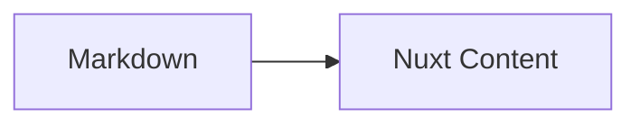

# AEBC08 的个人博客

这是 [AEBC08](https://github.com/AEBC08) 的个人博客，使用 **Mifumi** 框架构建：**Nuxt 4**、**Nuxt Content v3**、**miuix-vue** 与 **Tailwind CSS v4**，部署在 GitHub Pages：<https://aebc08.github.io/blog/>。

Mifumi 是这个博客使用的静态博客框架名称。

## 功能

- 文件即文章：在 `content/posts/` 下新增 `.md` 即可发布
- 独立关于页：`content/pages/about.md` 提供 Markdown 内容，`app/pages/about.vue` 负责布局与 Vue 组件
- `draft: true` 的文章不会出现在列表，直接访问也会返回 404
- 顶部导航 + 侧边栏 widget + 主内容的响应式双栏布局
- 亮色 / 暗色主题，首屏无闪烁，Mermaid 主题同步
- KaTeX 数学公式、Shiki 双主题代码高亮、Mermaid 图表
- MDC 组件：`Callout`、`Spoiler`、`LinkCard`（`ClientOnly`，图标背景可配置）与 `GithubRepo` 仓库卡片（语言 / Star / Fork / 许可证在构建期读 GitHub API，可逐项关闭，可选所有者头像；客户端导航时显示骨架占位）
- 统一图标系统：`Icon` 组件 + Tabler / miuix 图标注册表，正文可用 `:icon{name="..."}` 内联
- 自定义 `ProseH2`、`ProseImg` 覆盖生效：正文图片统一懒加载、异步解码、加载完成淡入
- 文章页评论区（giscus，基于 GitHub Discussions，免后端）与友链页（`/friends`）
- 目录高亮跟随滚动（支持 h2/h3 两级，当前项自动滚入目录视野）
- `layout: interactive` 的文章由 Vue 组件渲染

## 站点配置

站点名称、描述、个人信息、导航、页脚与首页横幅统一写在根目录 **`site.config.ts`**，这是唯一数据源：

- `nuxt.config.ts` 读取它生成 `<head>` 的 `title`、`description` 与 `html lang`
- `app/app.config.ts` 把它交给 `useAppConfig()`，组件不再硬编码站点身份信息

改站点名只需改 `site.title` / `site.author` / `profile.name`；顶栏标题、浏览器标题、页脚版权、横幅品牌小字都会跟随（`hero.title`、`hero.tagline`、`hero.decoration.brandLabel` 留空时分别继承 `profile.name`、`site.tagline`、`site.title`）。

| 分组 | 内容 |
| --- | --- |
| `site` | 标题、作者、描述、标语、站点地址、语言、标题分隔符 |
| `profile` | 侧边栏名片的姓名、简介、头像、状态、链接 |
| `navigation` | 顶部导航项 |
| `header.socialLinks` | 顶栏右侧图标链接，清空数组即可隐藏整组 |
| `footer` | 版权模板（`{year}` / `{author}` 占位）、许可声明、技术栈链接、附加链接、头像开关 |
| `hero` | 首页横幅的外观、装饰、文案、按钮、统计与动效 |
| `effects` | 全局视觉动效：页面切换过渡、顶部滚动进度条、内容滚动渐显 |
| `comments` | giscus 评论区的仓库与主题参数 |
| `friends` | 友链页的说明文字与友链条目 |

页脚版权默认是 `© {year} {author}`；`footer.extraLinks` 可放备案号等额外链接。

## 全局视觉动效

`site.config.ts` 的 `effects` 分组控制三类全局动效，均可独立关闭：

| 配置 | 说明 |
| --- | --- |
| `pageTransition` | 路由切换时旧页面淡出上移、新页面上浮进场（构建期读取，改后需重新构建） |
| `scrollProgress` | 视口顶部 2px 蓝色渐变阅读进度条，随页面滚动填充，回到顶部自动隐藏 |
| `reveal` | 文章卡片与侧边栏卡片进入视口时渐显上浮，列表按 60ms 错峰（封顶 360ms） |

实现细节：过渡类是 `main.css` 里的 `.page-enter-*` / `.page-leave-*`；进度条组件是 `app/components/layout/ScrollProgress.vue`（`transform: scaleX` 驱动，只在合成层更新）；渐显由 `app/plugins/reveal.ts` 注册的 `v-reveal` 指令实现（IntersectionObserver），隐藏态只由 JS 添加，SSR 与无 JS 环境内容始终可见。顶栏在页面滚动后会加深阴影形成贴附态。所有动效均尊重 `prefers-reduced-motion`。

图片处理：`ProseImg.vue` 覆盖让正文图片统一 `loading="lazy"` + `decoding="async"`；`app/plugins/img-fade.ts` 注册的 `v-img-fade` 指令让图片加载完成后淡入（隐藏态同样只由 JS 添加，无 JS 不退化）。文章卡封面除精选卡（首屏 LCP，eager）外均懒加载。

## 评论区

文章页底部接入 **giscus**（基于 GitHub Discussions，静态站免后端）：

1. 把目标仓库的 Discussions 打开，并在仓库安装 [giscus app](https://github.com/apps/giscus)
2. 打开 <https://giscus.app>，按向导填仓库名，选择分类（建议 Announcements）
3. 把生成的 `repoId`、`categoryId` 填进 `site.config.ts` 的 `comments.giscus`——**这四项没填全之前评论区不渲染**，避免线上挂空壳

评论组件 `app/components/post/CommentSection.vue` 懒挂载（滚动到附近才加载脚本），主题跟随站点明暗切换。`comments.enabled: false` 可整体关闭。`layout: interactive` 的文章默认不显示评论区。

## 友链页

`/friends` 页面（顶栏导航「友链」）的数据全部来自 `site.config.ts` 的 `friends` 分组：`intro` 是页面说明，`links` 是友链条目（`name` / `href` 必填，`avatar` 留空显示首字母占位，`description` 可选）。数组为空时显示访客向的占位提示。

页面顶部有「本站信息」栏目：站点名称 / 地址 / 头像 / 描述**逐项展示，每项右侧有独立的复制按钮**，卡片右上角的「全部复制」一次复制全部四项（头像等站内路径复制时自动补全为带域名的完整 URL）。本站信息默认从 `site` / `profile` 派生，也可以在 `site.config.ts` 的 `siteInfo` 分组里**单独配置**（`name` / `url` / `avatar` / `description`），留空的字段继续回退到站点默认值。

## 首页横幅

首页顶部横幅由 `app/components/layout/HeroBanner.vue` 渲染，**亮/暗两套配色由 CSS 令牌驱动**，跟随站点主题自动切换，首屏不闪烁：浅色主题是白底深色字，深色主题是深蓝黑底白色字。`public/banner-light.svg` 与 `public/banner.svg` 是配套的白色 / 黑色底图资源。

在 `site.config.ts` 的 `hero` 里调整：

| 配置 | 说明 |
| --- | --- |
| `appearance` | `auto` 跟随站点主题；`light` / `dark` 固定使用某一套配色（可与站点主题相反） |
| `background` | `gradient`（默认）= CSS 绘制背景，装饰层可逐项动画；`image` = 使用上面两张 SVG 底图并按主题切换 |
| `decoration` | `brandMark` / `brandLabel` / `grid` / `monogram` / `accentBar` / `glow` 各自开关 |
| `eyebrow`、`title`、`titleSuffix`、`tagline`、`showAvatar` | 横幅文案与头像，留空时继承站点信息 |
| `actions` | 按钮数组，`variant` 为 `primary` / `ghost` |
| `stats` | 统计项，可增删、改顺序、用 `enabled` 关闭；`key` 为 `posts` / `categories` / `tags` |
| `motion` | 动效总开关与参数，见下 |

`motion` 参数：`enabled`（总开关）、`preset`（`subtle` / `standard` / `playful`，作为整体倍率）、`duration` / `stagger` / `delay` / `distance`（入场节奏，秒与像素）、`background`（背景渐显）、`parallax`（鼠标视差）、`float`（光晕漂浮）、`countUp`（数字滚动）、`hover`（悬停反馈）。所有动效都遵循 `prefers-reduced-motion`：系统开启「减少动态效果」时自动关闭。

## 本地开发

```bash
pnpm install
pnpm dev
```

打开终端提示的地址即可。开发模式下新增/修改 Markdown 会自动刷新。

## 新增文章

```bash
pnpm new-post hello-world
pnpm new-post notes/nuxt-content
```

脚本行为：

- 参数缺失时以退出码 `1` 结束
- 自动创建嵌套目录
- 文件名统一转成小写
- 使用 `flag: 'wx'` 写入，**不会覆盖已有文件**
- 生成完整 frontmatter，`published` 为 ISO 时间，`draft` 默认 `true`，`layout` 默认 `default`

生成后把 `draft` 改为 `false` 即可发布。

## 目录结构

```text
site.config.ts        # 站点名称、页脚、导航、横幅等全部站点级配置（唯一数据源）
app/                  # Nuxt 4 源码目录（页面、组件、composables、样式）
content/posts/        # Markdown 文章，嵌套目录自动成为嵌套 slug
content/pages/        # 独立页面（关于页），由 pages 集合渲染
public/               # 封面、头像（同时用作浏览器标签页图标）、.nojekyll
memory/               # 分类的技术决策记录（含索引）
scripts/new-post.mjs  # 发帖脚本
content.config.ts     # blog / pages 集合与 schema
nuxt.config.ts        # baseURL、Content、Mermaid、Tailwind、prerender 配置
```

## Frontmatter

```yaml
---
title: 文章标题
published: 2026-10-01T09:00:00.000Z
description: 列表页摘要
tags:
  - Nuxt
category: 公告
draft: false
image: /covers/hello.svg
layout: default # 或 interactive
lang: zh-CN
---
```

- `title`：标题，同时用于 `<title>`
- `published`：ISO 时间，列表按它降序排列
- `draft`：`true` 时不可见、不可访问
- `image`：写 `public/` 下的站点绝对路径，运行时自动拼接部署前缀
- `layout`：`default` 用 `ContentRenderer`，`interactive` 用 `InteractivePost.vue`

## Markdown 约定

数学公式只使用 `$...$` 与 `$$...$$`：

```md
行内 $E = mc^2$

$$
\int_{-\infty}^{\infty} e^{-x^2} \, dx = \sqrt{\pi}
$$
```

> **不要使用 ` ```math ` 围栏。** Nuxt Content v3 会把它当作普通代码块，`remark-math` 不会生效。

代码高亮使用 Shiki 的 `github-light` / `github-dark` 双主题，暗色模式由 `.dark` class 切换。Mermaid 使用：

````md

````

MDC 组件示例：

```md
::Callout{type="tip" title="提示"}
内容
::

::Spoiler{label="点击展开"}
隐藏内容
::

::LinkCard{title="Nuxt Content" description="文件式 CMS" href="https://content.nuxt.com" icon="brand-nuxt"}
::
```

### 内联图标

正文使用 MDC 行内组件语法插入图标：

```md
系统主题： :icon{name="sun-moon"} 跟随系统
miuix 图标： :icon{name="miuix:Folder"} 文件夹
```

- 默认名称是 Tabler 的 kebab-case（`arrow-right`、`brand-github`），也可以写 `tabler:` 前缀。
- `miuix:` 前缀读取 miuix-vue 的扩展图标，名称保持 PascalCase（`miuix:Folder`）。
- 未知名称会渲染为 `help-circle` 兜底，不会中断构建。
- `remark-mdc` 要求 `:icon` 前是行首、空白或 `[`、`*`、`_`、`(`。中文全角标点后请补一个空格，否则会保留为字面文本。

## 检查与构建

```bash
pnpm lint
pnpm typecheck
pnpm build
pnpm preview
```

## 部署到 GitHub Pages

工作流位于 `.github/workflows/deploy.yml`，推送到 `main` 时自动执行 lint、typecheck、构建并发布 `.output/public`。

关键配置：

- `NUXT_APP_BASE_URL=/${{ github.event.repository.name }}/`：项目站点子路径
- `npx nuxt build --preset github_pages`
- `GITHUB_TOKEN`：构建期读取仓库卡片数据，避免匿名 API 的 60 次/小时限制
- `app.buildAssetsDir: 'nuxt_assets'`：避免 GitHub Pages 忽略 `_nuxt` 这类下划线目录
- `public/.nojekyll`：关闭 Jekyll 处理
- `nitro.prerender.autoSubfolderIndex: true`：生成 `posts/hello/index.html`（对外 URL 为 `/blog/posts/hello/`），带尾斜杠刷新直接命中，无尾斜杠由静态服务器 301 到目录

本地模拟子路径构建：

```bash
# PowerShell
$env:NUXT_APP_BASE_URL="/blog/"
pnpm exec nuxt build --preset github_pages

# 用任意静态服务器托管 .output/public，并访问 /blog/
```

如果使用自定义域名或用户站点（`<user>.github.io`），把 `NUXT_APP_BASE_URL` 设为 `/`。

## 许可

- **代码**（`.vue` / `.ts` / 配置与脚本等）采用 [MIT](LICENSE) 许可协议，`package.json` 的 `license` 字段同为 `MIT`。
- **内容**（`content/` 下的文章与 `public/` 下的封面等创作内容）除特别注明外，采用 [CC BY-NC-SA 4.0](https://creativecommons.org/licenses/by-nc-sa/4.0/deed.zh-hans)：允许署名转载与改编，但不得用于商业目的，衍生作品需以相同协议共享。

Nuxt、Nuxt Content、miuix-vue、Tabler 图标等依赖仍遵循各自的上游许可证（如 miuix-vue 为 Apache-2.0），与本仓库的 MIT 无关。

