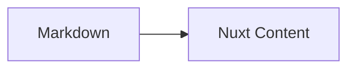

# AEBC08 的个人博客

这是 [AEBC08](https://github.com/AEBC08) 的个人博客，使用 **Mifumi** 框架构建：**Nuxt 4**、**Nuxt Content v3**、**miuix-vue** 与 **Tailwind CSS v4**，部署在 GitHub Pages：<https://aebc08.github.io/blog/>。

Mifumi 是这个博客使用的静态博客框架名称。

## 功能

- 文件即文章：在 `content/posts/` 下新增 `.md` 即可发布
- 独立关于页：`content/pages/about.md` 提供 Markdown 内容，`app/pages/about.vue` 负责布局与 Vue 组件
- `draft: true` 的文章不会出现在列表，直接访问也会返回 404
- 顶部导航 + 侧边栏 widget + 主内容的响应式双栏布局
- 亮色 / 暗色主题，首屏无闪烁，Mermaid 主题同步
- KaTeX 数学公式、Shiki 双主题代码高亮、Mermaid 图表
- MDC 组件：`Callout`、`Spoiler`、`LinkCard`（`ClientOnly`，图标背景可配置）与 `GithubRepo` 仓库卡片（语言 / Star / Fork / 许可证在构建期读 GitHub API，可逐项关闭，可选所有者头像）
- 统一图标系统：`Icon` 组件 + Tabler / miuix 图标注册表，正文可用 `:icon{name="..."}` 内联
- 自定义 `ProseH2` 覆盖生效
- `layout: interactive` 的文章由 Vue 组件渲染

## 本地开发

```bash
pnpm install
pnpm dev
```

打开终端提示的地址即可。开发模式下新增/修改 Markdown 会自动刷新。

## 新增文章

```bash
pnpm new-post hello-world
pnpm new-post notes/nuxt-content
```

脚本行为：

- 参数缺失时以退出码 `1` 结束
- 自动创建嵌套目录
- 文件名统一转成小写
- 使用 `flag: 'wx'` 写入，**不会覆盖已有文件**
- 生成完整 frontmatter，`published` 为 ISO 时间，`draft` 默认 `true`，`layout` 默认 `default`

生成后把 `draft` 改为 `false` 即可发布。

## 目录结构

```text
app/                  # Nuxt 4 源码目录（页面、组件、composables、样式）
content/posts/        # Markdown 文章，嵌套目录自动成为嵌套 slug
content/pages/        # 独立页面（关于页），由 pages 集合渲染
public/               # 封面、头像（同时用作浏览器标签页图标）、.nojekyll
memory/               # 分类的技术决策记录（含索引）
scripts/new-post.mjs  # 发帖脚本
content.config.ts     # blog / pages 集合与 schema
nuxt.config.ts        # baseURL、Content、Mermaid、Tailwind、prerender 配置
```

## Frontmatter

```yaml
---
title: 文章标题
published: 2026-10-01T09:00:00.000Z
description: 列表页摘要
tags:
  - Nuxt
category: 公告
draft: false
image: /covers/hello.svg
layout: default # 或 interactive
lang: zh-CN
---
```

- `title`：标题，同时用于 `<title>`
- `published`：ISO 时间，列表按它降序排列
- `draft`：`true` 时不可见、不可访问
- `image`：写 `public/` 下的站点绝对路径，运行时自动拼接部署前缀
- `layout`：`default` 用 `ContentRenderer`，`interactive` 用 `InteractivePost.vue`

## Markdown 约定

数学公式只使用 `$...$` 与 `$$...$$`：

```md
行内 $E = mc^2$

$$
\int_{-\infty}^{\infty} e^{-x^2} \, dx = \sqrt{\pi}
$$
```

> **不要使用 ` ```math ` 围栏。** Nuxt Content v3 会把它当作普通代码块，`remark-math` 不会生效。

代码高亮使用 Shiki 的 `github-light` / `github-dark` 双主题，暗色模式由 `.dark` class 切换。Mermaid 使用：

````md

````

MDC 组件示例：

```md
::Callout{type="tip" title="提示"}
内容
::

::Spoiler{label="点击展开"}
隐藏内容
::

::LinkCard{title="Nuxt Content" description="文件式 CMS" href="https://content.nuxt.com" icon="brand-nuxt"}
::
```

### 内联图标

正文使用 MDC 行内组件语法插入图标：

```md
系统主题： :icon{name="sun-moon"} 跟随系统
miuix 图标： :icon{name="miuix:Folder"} 文件夹
```

- 默认名称是 Tabler 的 kebab-case（`arrow-right`、`brand-github`），也可以写 `tabler:` 前缀。
- `miuix:` 前缀读取 miuix-vue 的扩展图标，名称保持 PascalCase（`miuix:Folder`）。
- 未知名称会渲染为 `help-circle` 兜底，不会中断构建。
- `remark-mdc` 要求 `:icon` 前是行首、空白或 `[`、`*`、`_`、`(`。中文全角标点后请补一个空格，否则会保留为字面文本。

## 检查与构建

```bash
pnpm lint
pnpm typecheck
pnpm build
pnpm preview
```

## 部署到 GitHub Pages

工作流位于 `.github/workflows/deploy.yml`，推送到 `main` 时自动执行 lint、typecheck、构建并发布 `.output/public`。

关键配置：

- `NUXT_APP_BASE_URL=/${{ github.event.repository.name }}/`：项目站点子路径
- `npx nuxt build --preset github_pages`
- `GITHUB_TOKEN`：构建期读取仓库卡片数据，避免匿名 API 的 60 次/小时限制
- `app.buildAssetsDir: 'nuxt_assets'`：避免 GitHub Pages 忽略 `_nuxt` 这类下划线目录
- `public/.nojekyll`：关闭 Jekyll 处理
- `nitro.prerender.autoSubfolderIndex: true`：生成 `posts/hello/index.html`（对外 URL 为 `/blog/posts/hello/`），带尾斜杠刷新直接命中，无尾斜杠由静态服务器 301 到目录

本地模拟子路径构建：

```bash
# PowerShell
$env:NUXT_APP_BASE_URL="/blog/"
pnpm exec nuxt build --preset github_pages

# 用任意静态服务器托管 .output/public，并访问 /blog/
```

如果使用自定义域名或用户站点（`<user>.github.io`），把 `NUXT_APP_BASE_URL` 设为 `/`。

## 许可

- **代码**（`.vue` / `.ts` / 配置与脚本等）采用 [MIT](LICENSE) 许可协议，`package.json` 的 `license` 字段同为 `MIT`。
- **内容**（`content/` 下的文章与 `public/` 下的封面等创作内容）除特别注明外，采用 [CC BY-NC-SA 4.0](https://creativecommons.org/licenses/by-nc-sa/4.0/deed.zh-hans)：允许署名转载与改编，但不得用于商业目的，衍生作品需以相同协议共享。

Nuxt、Nuxt Content、miuix-vue、Tabler 图标等依赖仍遵循各自的上游许可证（如 miuix-vue 为 Apache-2.0），与本仓库的 MIT 无关。

