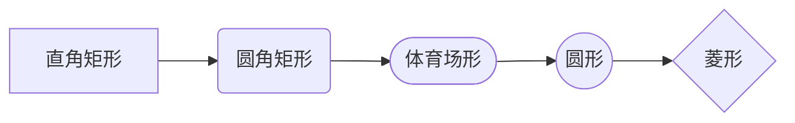
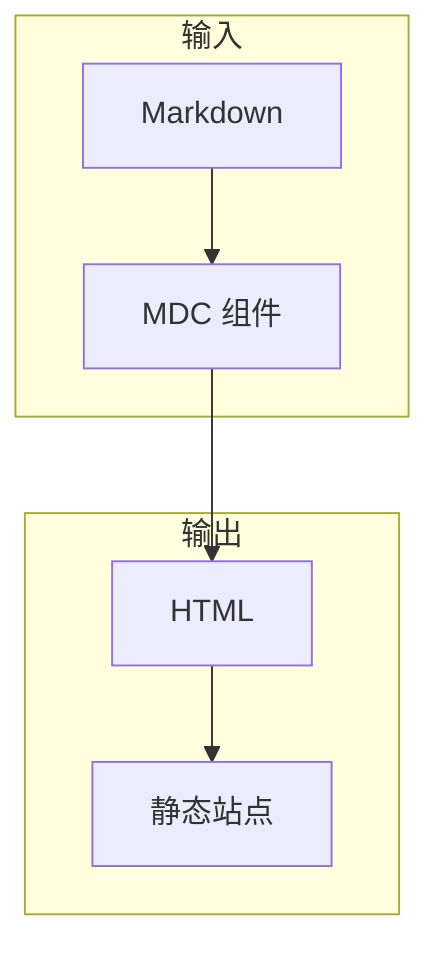
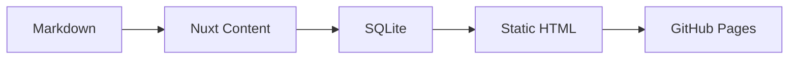

## 图标

正文里可以用 MDC 行内组件语法插入图标：`:icon{name="..."}`。默认名称使用
Tabler 的 kebab-case，`:icon{name="miuix:Folder"}` 这样的 `miuix:` 前缀则会
读取 miuix-vue 自带的扩展图标。

- 系统主题： :icon{name="device-desktop"} 桌面
- 浅色主题： :icon{name="sun"} 太阳
- 深色主题： :icon{name="moon"} 月亮
- miuix 图标： :icon{name="miuix:Folder"} 文件夹， :icon{name="miuix:Copy"} 复制， :icon{name="miuix:Ok"} 完成
- 品牌图标： :icon{name="brand-github"} GitHub， :icon{name="brand-nuxt"} Nuxt， :icon{name="brand-vue"} Vue
- 语义图标： :icon{name="info-circle"} 信息， :icon{name="alert-triangle"} 警告， :icon{name="circle-check"} 通过

## 数学公式

行内公式：$E = mc^2$，以及欧拉恒等式 $e^{i\pi} + 1 = 0$。

块级公式：

$$
\int_{-\infty}^{\infty} e^{-x^2} \, dx = \sqrt{\pi}
$$

> 在 Nuxt Content v3 中，` ```math ` 围栏会被当成代码块，请统一使用 `$...$` 与 `$$...$$`。

## 代码高亮

```ts
interface PostMeta {
  title: string
  published: Date
  tags: string[]
}

function formatTags(meta: PostMeta): string {
  return meta.tags.map(tag => `#${tag}`).join(' ')
}
```

```bash
pnpm new-post notes/nuxt-content
pnpm dev
```

## Mermaid

Mermaid 的主题、字体与配色来自 `nuxt.config.ts` 中的 `themeCSS`，没有在
`main.css` 里覆盖节点几何，所以放大后仍能区分直角矩形与圆角矩形：



子图与普通流程：





## Callout

::Callout{type="info" title="提示"}
Callout 的 `type` 支持 `info`、`tip`、`warning`、`danger`。
::

::Callout{type="warning" title="注意"}
静态部署后刷新文章页需要处理尾斜杠，本项目已在构建阶段解决。
::

## Spoiler

::Spoiler{label="点击展开答案"}
因为 Markdown 的入口文件最终会被编译成 Vue 组件，而 MDC 语法让组件可以直接嵌入正文。
::

## LinkCard

::LinkCard{title="Nuxt Content" description="用 Markdown 驱动的文件式 CMS。" href="https://content.nuxt.com" icon="brand-nuxt"}
::

::LinkCard{title="miuix-vue" description="面向 Vue 3 的 HyperOS / miuix 组件库。" href="https://github.com/miuix-kotlin/miuix-vue" icon="brand-vue"}
::

## GFM

| 特性 | 是否支持 |
| --- | --- |
| 表格 | 是 |
| 任务列表 | 是 |
| 删除线 | 是 |

- [x] 表格
- [x] 任务列表
- [x] 删除线
- [ ] 更多语法

~~删除线示例~~
